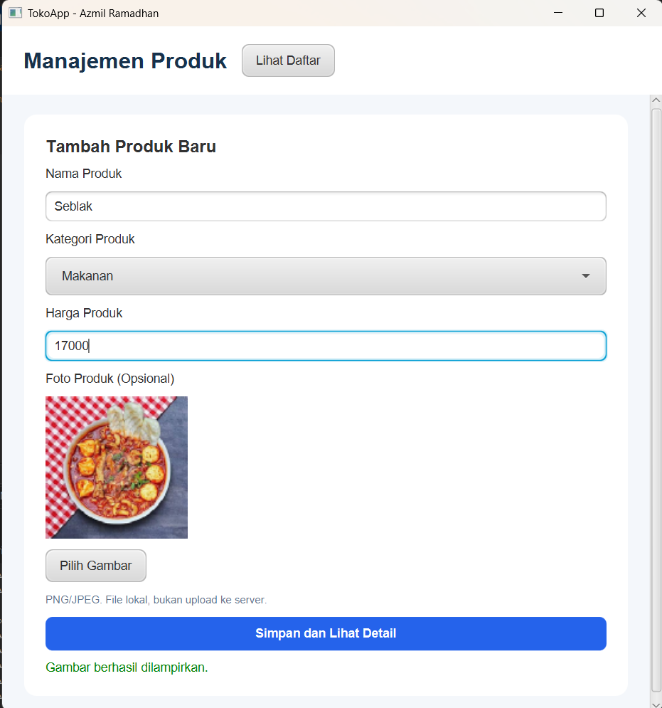
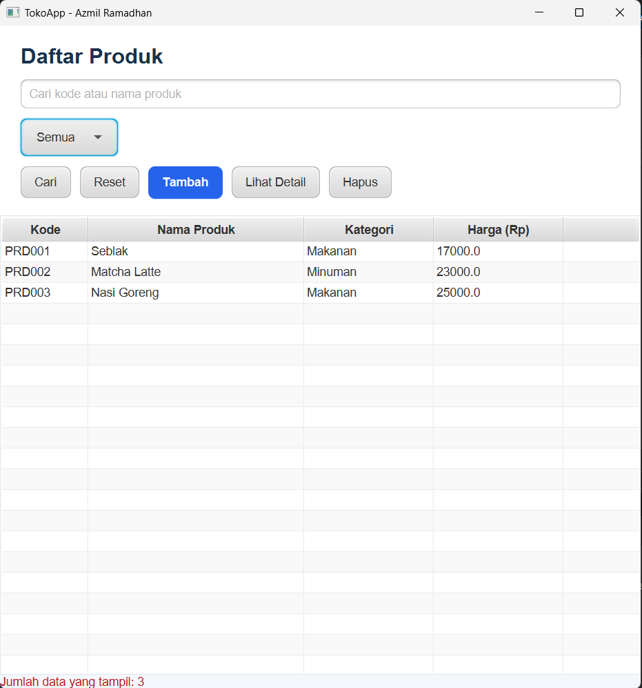
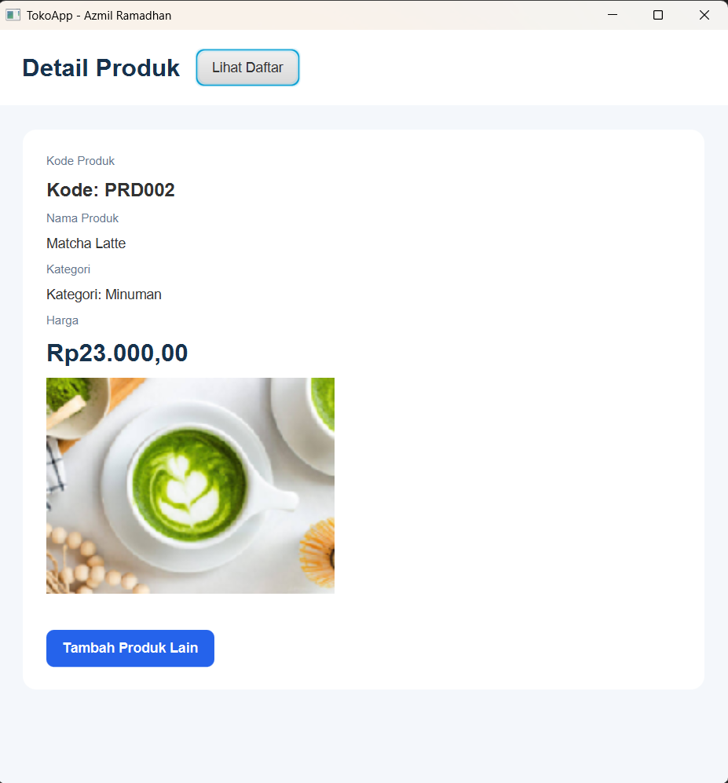

# Tugas Praktikum / Project: Aplikasi Toko (JavaFX)

Project ini adalah tugas pembuatan aplikasi desktop berbasis JavaFX untuk manajemen data produk Toko. Aplikasi ini dibuat menggunakan arsitektur **MVC (Model-View-Controller)** dan manajemen build **Maven**. 

Data disimpan secara sementara (*in-memory* menggunakan `ObservableList`), sehingga tidak memerlukan koneksi database.

* **Nama:** Azmil Ramadhan
* **NIM:** 2507764
* **Mata Kuliah:** Pemrograman Lanjut

---

## Fitur Aplikasi
Sesuai dengan spesifikasi tugas yang diberikan, aplikasi ini memiliki fitur:
1. **Form Tambah Produk:** Input nama, kategori, dan harga dengan validasi (nama tidak boleh kosong, harga > 0).
2. **Daftar Produk (Tabel):** Menampilkan semua produk yang sudah diinput.
3. **Pencarian & Filter:** Bisa mencari berdasarkan nama/kode produk dan filter berdasarkan kategori (Makanan/Minuman).
4. **Detail Produk:** Menampilkan detail data produk yang di-klik dari tabel.
5. **Upload Gambar:** Bisa melampirkan foto produk dari file lokal (opsional).
6. **Styling CSS:** UI diperbagus menggunakan CSS khusus.

---

## UI Aplikasi

### 1. Halaman Form Tambah Produk

### 2. Halaman Daftar Produk

### 3. Halaman Detail Produk

---

## Cara Menjalankan Aplikasi di NetBeans

Karena project ini menggunakan Java 11/17+ dan Maven, eksekusi program harus dilakukan melalui class *launcher* biasa untuk menghindari error module JavaFX. 

Ikuti langkah-langkah berikut untuk menjalankan aplikasinya:

1. **Buka Project:** Buka IDE NetBeans, klik `File` -> `Open Project`, lalu pilih folder project `Toko` ini.
2. **Clean and Build (Wajib):** 
   * Di panel *Projects* sebelah kiri, klik kanan pada nama project **Toko**.
   * Pilih **Clean and Build**. 
   * Tunggu proses Maven selesai mengunduh *dependencies* JavaFX dan melakukan *compile* sampai muncul tulisan `BUILD SUCCESS`.
3. **Run Program:**
   * Masuk ke folder `Source Packages` -> `kelas`.
   * **Penting:** Jangan jalankan dari `MainApp.java`.
   * Klik kanan pada file **`Main.java`**, lalu pilih **Run File** (atau tekan `Shift + F6`).
   * Aplikasi akan langsung terbuka.

---

## Struktur MVC
Project ini dibagi menjadi beberapa package agar rapi:
* `kelas.model`: Berisi rancangan objek `Produk.java`.
* `kelas.data`: Berisi `DataProduk.java` untuk menyimpan *list* produk.
* `kelas.controller`: Berisi controller untuk tiap halaman FXML.
* `kelas`: Berisi konfigurasi utama (`Main`, `MainApp`, dan `Navigator`).
